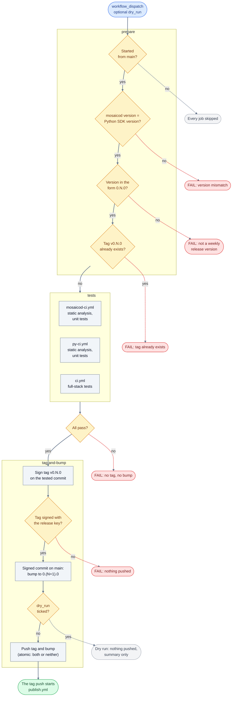
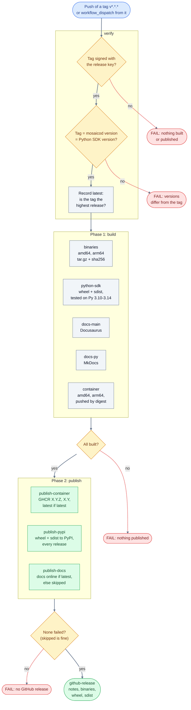

# Releasing

This document describes how a release is cut and published. The release cycle
itself, with weekly releases and security updates, is described in
[`docs/main/docs/dev/release_cycle.md`](docs/main/docs/dev/release_cycle.md).

Two workflows are involved. `release.yml` tests `main`, tags it with a signed
tag and bumps the version. The push of that tag starts `publish.yml`, which
builds every artifact and publishes them only if all of them were built: the
container image on GHCR, the Python SDK on PyPI, the docs online and the GitHub
release.

In the diagrams below, solid arrows follow a successful run and dashed arrows
lead to where a run stops, in red when the run fails. An arrow into a box
starts all the jobs inside it in parallel. The colors mark the kind of each
node:

- blue: what starts the workflow;
- yellow: a check;
- grey: a step;
- green: what gets published;
- red: a failure;
- light grey: a stop that is not a failure.

## `release.yml`: weekly release

A maintainer starts the workflow by hand from the Actions tab. Releases are cut
only from `main`, so a run started from another branch skips every job.

1. **prepare** reads the versions of `mosaicod` and of the Python SDK. They
   must be equal, because both are released together. The version must also
   be in the form `0.N.0`: this workflow cuts only weekly releases, while
   security updates are tagged by hand. Finally, the tag `v0.N.0` must not
   exist yet, so the same release can't be cut twice.
2. **Tests.** The checks that run on pull requests also run on the commit to
   release: static analysis and unit tests of `mosaicod` (`mosaicod-ci.yml`)
   and of the Python SDK (`py-ci.yml`), and the full-stack tests (`ci.yml`).
   If any of them fails, nothing is tagged.
3. **tag-and-bump** signs the tag `v0.N.0` on the tested commit and checks the
   signature against the public release key. Then it bumps the version to
   `0.(N+1).0` in the manifests and in the lock files, with a signed commit on
   the latest `main`. The tag stays on the tested commit, even if `main` moved
   during the tests. The tag and the bump are pushed together in an atomic
   push, so either both land or neither does. With `dry_run` ticked, nothing
   is pushed and the run only writes its summary, with the tag and the next
   version.

The workflow pushes with a GitHub App instead of `GITHUB_TOKEN`. The App is
allowed to push to the protected `main`, and its pushes trigger other
workflows, while those made with `GITHUB_TOKEN` don't. This way, the tag push
starts `publish.yml`.

## `publish.yml`: build and publish

The workflow starts on the push of a release tag. A weekly release is tagged by
`release.yml`, while a security update is tagged by hand on a temporary branch.
A run can also be started again from the tag with `workflow_dispatch`.

1. **verify** checks that the tag is signed with the release key and that
   `mosaicod` and the Python SDK have the version of the tag. Then it records
   whether the tag is the highest release. This check never fails the run: it
   only decides whether phase 2 replaces the `latest` container tag, the online
   docs and the latest GitHub release.
2. **Phase 1: build.** Every artifact is built in parallel, and nothing is
   public yet:
   - `binaries`: the `mosaicod` binaries for amd64 and arm64, as tarballs with
     their checksums;
   - `python-sdk`: the wheel and the sdist, built once by `py-wheel.yml`. The
     wheel runs the unit, full-stack and CLI smoke tests on Python 3.10 to
     3.14, so the files that get published are the files that were tested;
   - `docs-main` and `docs-py`: the Docusaurus docs and the MkDocs docs of the
     Python SDK;
   - `container`: one image per platform, pushed to GHCR by digest only.
     Without a tag, nobody sees them yet.

   If any build fails, the run stops and nothing is published.
3. **Phase 2: publish.** These jobs only upload what phase 1 built:
   - `publish-container` joins the two images into a multi-platform image with
     the tags `X.Y.Z` and `X.Y`. Only the highest release also gets `latest`;
   - `publish-pypi` uploads the wheel and the sdist to PyPI. A security update
     of an older release is uploaded too, because pip always installs the
     highest version anyway;
   - `publish-docs` replaces the online docs, only for the highest release. For
     an older release it is skipped.
4. **github-release** runs last, so a release is announced only once it is
   available everywhere. It also runs when `publish-docs` is skipped, but never
   after a failed or cancelled job. It writes the release notes with git-cliff
   and attaches the binaries with their checksums, the wheel and the sdist.
   Only the highest release is marked as the latest GitHub release.

A failed publish job can be retried with "Re-run failed jobs", which uploads
the artifacts already built. Starting the workflow again with
`workflow_dispatch` builds every artifact from scratch instead. In both cases,
`publish-pypi` skips the files that are already on PyPI, because a version
uploaded there can never be replaced.

## Setup

`publish-pypi` uploads with [Trusted
Publishing](https://docs.pypi.org/trusted-publishers/), so it needs no API
token. It requires:

- a trusted publisher on the PyPI project `mosaicolabs`, with repository
  `mosaico-labs/mosaico`, workflow `publish.yml` and environment `pypi`;
- a `pypi` environment in the repository settings, with its deployments
  restricted to the release tags (`v*`), so no other ref can publish.

The secrets and variables of the other jobs are listed at the top of
`release.yml` and `publish.yml`.
